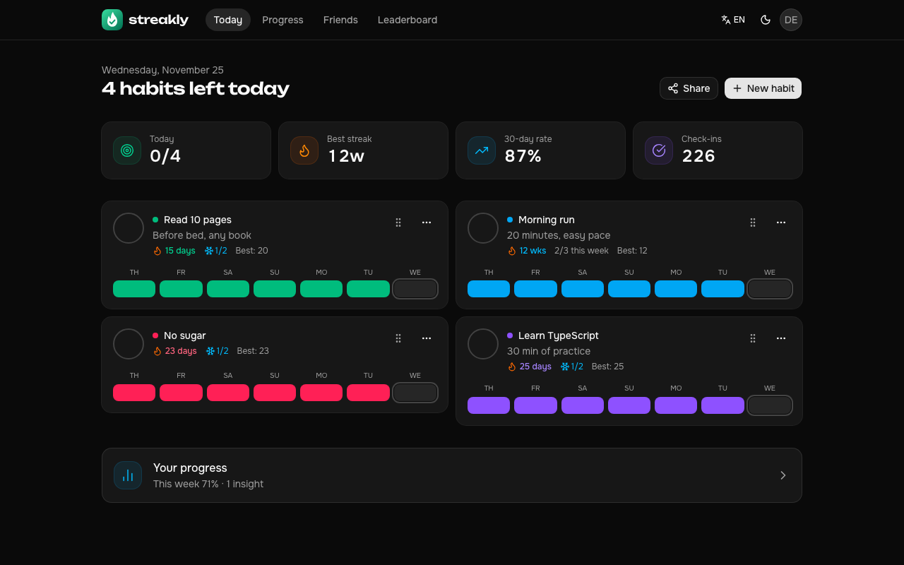
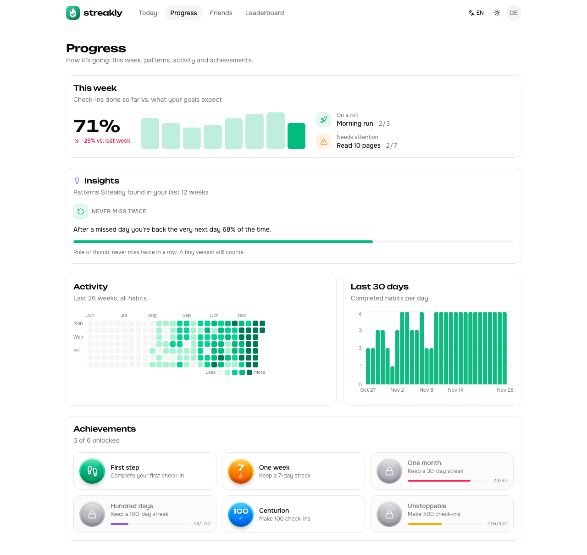
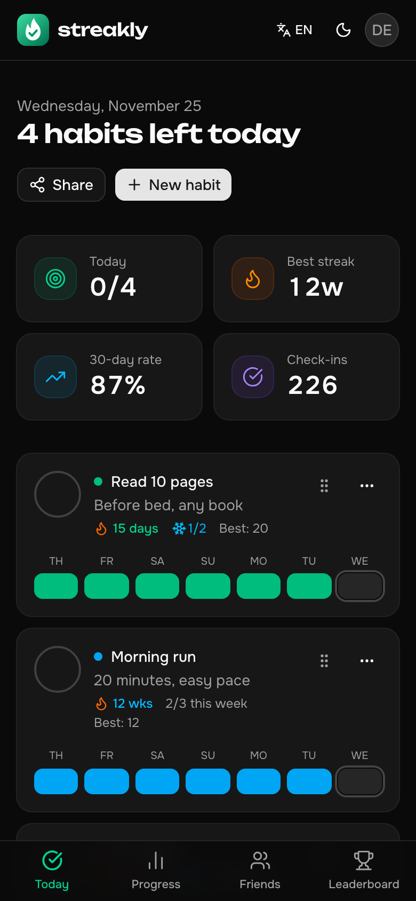
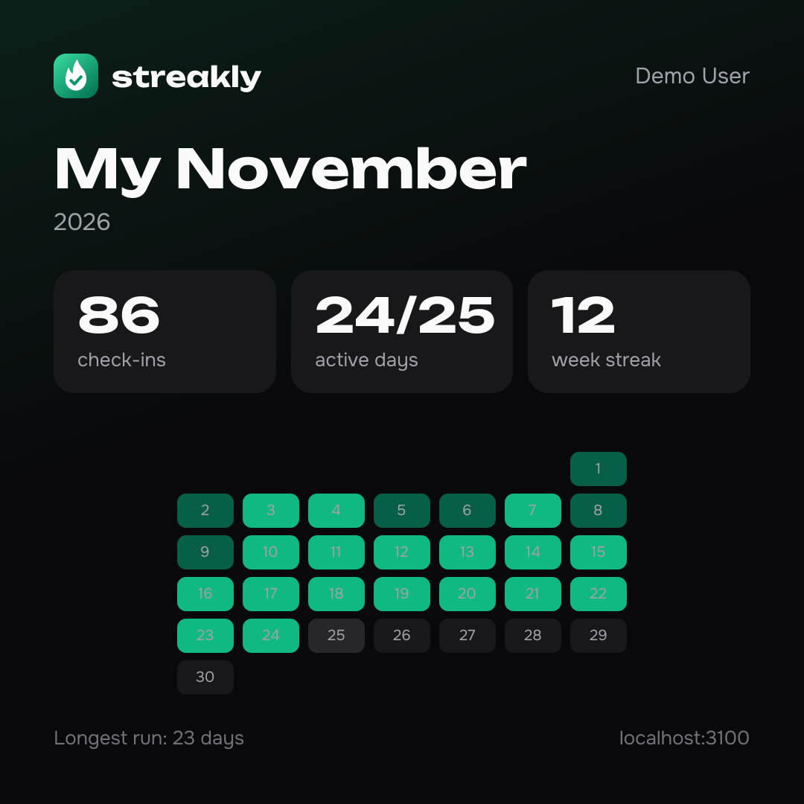
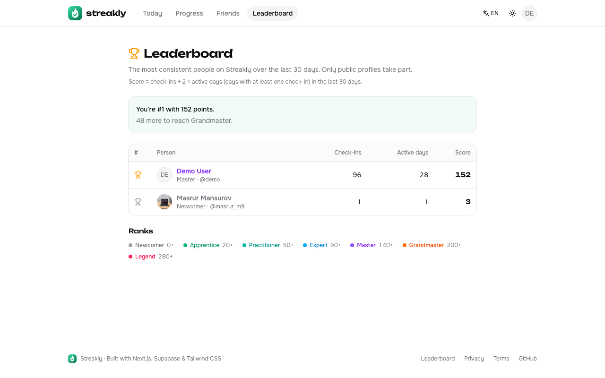
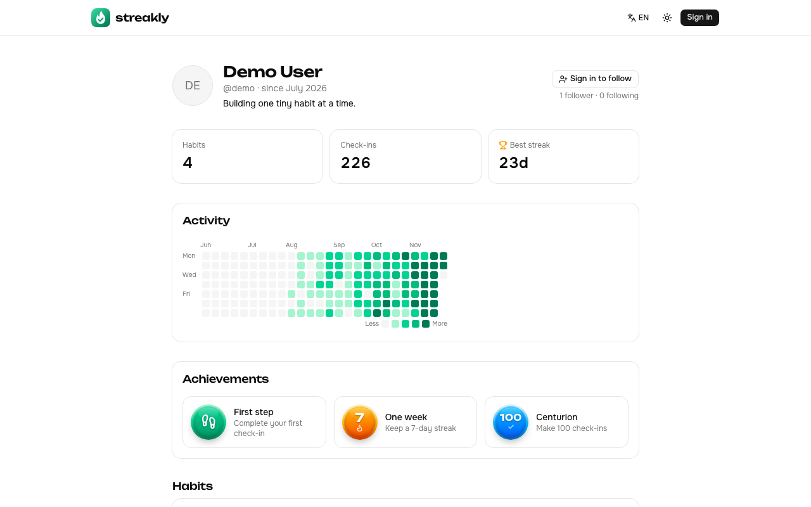

<p align="center">
  
</p>

<h1 align="center">Streakly</h1>

<p align="center">
  <b>A habit tracker built around how habits actually stick</b> — forgiving streaks, if-then plans,<br/>
  shared streaks with friends and insights mined from your own history.
</p>

<p align="center">
  <a href="https://github.com/MasrurMansurov/streakly/actions/workflows/ci.yml"></a>
  
  
  
  <a href="LICENSE"></a>
</p>

<p align="center">
  <a href="https://streakly-pied-six.vercel.app"><b>Live app</b></a> ·
  <a href="https://streakly-pied-six.vercel.app/en/u/demo">Demo profile</a> ·
  <a href="https://streakly-pied-six.vercel.app/en/leaderboard">Leaderboard</a>
</p>

<p align="center">
  Try it with the demo account: <code>demo@streakly.dev</code> / <code>streakly-demo</code> — or sign in with Google.
</p>

<p align="center">
  
  
</p>
<p align="center">
  
  
</p>
<p align="center">
  
  
  
</p>

---

## Contents

- [Why Streakly is different](#why-streakly-is-different)
- [Features](#features)
- [Tech stack](#tech-stack)
- [Architecture](#architecture)
- [Security & privacy](#security--privacy)
- [Testing & CI](#testing--ci)
- [Getting started](#getting-started)
- [Deployment](#deployment)
- [Roadmap](#roadmap)
- [License & credits](#license--credits)

## Why Streakly is different

Most trackers punish you for one bad day and then wonder why people quit. Streakly's features come from a
research review of retention mechanics (Duolingo, Strava, Wordle…) and habit-formation science:

| Idea | In Streakly | Why |
|---|---|---|
| Coming back should be cheap | Streak **freezes** (2/month), **repair** a missed day, **vacation mode**, a gentle note instead of "you broke it", a "welcome back" on return | Seeing a broken streak lowers continuation; repairability softens it. Rewarding the return after a miss was the best of 54 programs in a 61k-person megastudy |
| Do it when you remember | **One-tap check-in from the notification**, app-icon badge, **mini versions** ("at least 1 page") | Friction at the moment of intent is where habits die |
| Tie habits to a moment | **If-then plans** ("After my morning coffee → read") | Implementation intentions: d = 0.65 across 94 tests |
| Comparison beats support | **Pacts** (a shared streak that grows only when both check in), a **leaderboard** with ranks | In RCTs, competition and peer comparison outperform "supportive" designs |
| Show people their own patterns | **Insights**: habits that go together, weak weekdays, "never miss twice" rate | Self-monitoring works best when it's specific and actionable |

## Features

### Daily loop
- **Today screen** — one-tap check-ins with optimistic UI, a 7-day strip to fix past days, drag-and-drop ordering (mouse, touch, keyboard).
- **Flexible goals** — every day or N× per week (weekly habits keep streaks in weeks).
- **Mini versions** — "At least: 1 page" keeps the streak on a hard day; shown lighter and upgradable to a full check-in.
- **If-then plans** — a "When?" for each habit with one-tap suggestions; shown on the card and used in reminders.
- **Starter templates** — 8 ready-made habits (with plans and mini versions) on an empty dashboard.
- **Notes** on check-ins, an archive with restore and undo.

### Streaks that forgive
- **Freezes** — a single missed day doesn't break a daily streak, up to 2× a month per habit (two misses in a row still do). Derived from the check-ins, nothing stored.
- **Streak repair** — once a month per habit, a day missed yesterday or the day before; offered only when it revives a 3+ day streak.
- **Vacation mode** — up to 30 days: streaks are bridged (daily and weekly), reminders and pact nudges stay quiet. No retroactive pauses.

### Progress & insights
- **Weekly review** — this week vs. the same days of last week, an 8-week trend, the habit on a roll and the one falling behind.
- **Insights** from the last 12 weeks — habits that go together ("on days you run, you read 85% vs 40%"), a habit's weak weekday, your "never miss twice" recovery rate, and a nudge to add a plan to a struggling habit.
- **Activity heatmap** (26 weeks), a 30-day chart, a 12-month heatmap per habit, **achievements** drawn as CSS medals.

### Social
- **Find people** by name or @username and follow public profiles; a 7-day feed of their check-ins.
- **Pacts** — invite someone you follow: each commits one habit, the duo streak grows only on days you *both* check in, and your partner gets a push ("your turn" / "you both did it").
- **Leaderboard** of the last 30 days (score = check-ins + 2 × active days) with ranks from Newcomer to Legend.
- **Share cards** — a 1080×1080 PNG for the week, month or "My year in habits", shared via the Web Share API, downloaded, or copied as a Wordle-style emoji grid.
- **Public profile** at `/u/<username>` (opt-in) with a generated link preview.

### Reminders, PWA & offline
- **Daily reminder** at your time (Web Push) — only if something is still due; leads with the streak at risk and uses your if-then plan.
- **One-tap check-in from the notification** (Chrome/Edge/Android/Firefox; elsewhere a tap opens the right habit) and an app-icon badge with habits left.
- **Installable PWA** with a phone tab bar; **offline**: pages open without a connection, check-ins are queued on the device and synced later.

### Accounts, data & languages
- Email + password or **Google** sign-in (any provider enabled in Supabase shows up automatically); readable usernames generated from the Google name, Cyrillic transliterated.
- **Export** everything to CSV, **delete the account** (cascades through every table, avatar files included).
- **English & Russian** — `/en/…` and `/ru/…`, proper Russian plurals, localized dates, validation messages and push texts.
- Privacy policy and terms pages, light/dark themes, Vercel Analytics & Speed Insights.

## Tech stack

| | |
|---|---|
| Framework | **Next.js 16** — App Router, Server Actions, Cache Components (`"use cache"`, `cacheTag`/`updateTag`), Partial Prefetching, `proxy.ts`, `next/og` |
| Language | TypeScript (strict) |
| UI | Tailwind CSS v4, shadcn/ui on Base UI, lucide-react, Recharts, dnd-kit, sonner, next-themes; fonts Unbounded + Onest |
| Forms | react-hook-form + zod — the same schemas validate on the client and in Server Actions |
| Backend | **Supabase** — Postgres with Row Level Security, Auth (email + Google), Storage, Edge Functions (Deno), `pg_cron`, `pg_net`, Vault |
| Push | Web Push (VAPID) from an Edge Function; a service worker for notifications, actions and offline |
| Tests | Vitest (unit) + Playwright (e2e on desktop and a phone profile) |
| CI/CD | GitHub Actions (lint, typecheck, unit tests, build) · Vercel (auto-deploy from `main`, functions in `fra1` next to the database) |

## Architecture

```
src/
├── proxy.ts                    # locale redirect, auth guard + session refresh — only where needed
├── app/
│   ├── [locale]/               # every page lives under /en or /ru
│   │   ├── page.tsx            # landing (static)
│   │   ├── (app)/              # signed-in area: dashboard (Today), progress, friends,
│   │   │                       #   habits/[id], archive, settings
│   │   ├── leaderboard/        # public, cached
│   │   ├── u/[username]/       # public profile + generated OG image
│   │   ├── login/ privacy/ terms/
│   ├── actions/                # Server Actions — each re-checks the session, validates with zod
│   ├── api/checkin/            # one-tap check-in for notification buttons (same-origin only)
│   ├── api/share-card/         # PNG / emoji text share card (next/og)
│   └── auth/callback/          # email confirmation & OAuth → session
├── components/                 # app nav + tab bar, heatmap, medals, dialogs, shadcn/ui
├── i18n/                       # typed dictionaries (en, ru), plurals, server/client helpers
└── lib/
    ├── data.ts                 # data access layer (server-only)
    ├── streaks.ts              # streaks, freezes, repairs, vacation bridges   ┐
    ├── insights.ts review.ts   # patterns, weekly review                       │ pure,
    ├── pacts.ts share.ts       # duo streaks, share-card summaries              │ unit-tested
    ├── ranks.ts offline-queue.ts csv.ts dates.ts …                             ┘
    └── supabase/               # server, browser, proxy and public clients + generated types
supabase/
├── migrations/                 # schema, RLS policies, functions, triggers, cron (20 migrations)
└── functions/send-reminders/   # Web Push: daily reminders, pact nudges, test pushes
public/sw.js                    # service worker: push, notification actions, offline cache
```

### Data model

```
auth.users ─1:1─ profiles (username, display_name, bio, avatar_url, is_public)
                   ├─1:n─ habits (name, color, target_per_week, cue, mini_label, position, archived_at)
                   │        ├─1:n─ habit_logs   (log_date, is_mini)        unique(habit_id, log_date)
                   │        │        └─1:1─ habit_notes (note)
                   │        └─1:n─ habit_repairs (day)                     one per habit per month
                   ├─1:n─ pauses (start_date, end_date)                    vacation mode, ≤ 30 days
                   ├─n:m─ follows (follower_id, following_id)
                   ├─n:m─ pacts (inviter/invitee + their habits, status)  one per pair
                   ├─1:1─ reminder_settings (time, timezone, locale, enabled)
                   └─1:n─ push_subscriptions (endpoint, keys)
```

### How some of it works
- **Streaks are pure functions.** Freezes, repairs and vacation days are "bridges" that keep a run alive without counting as check-ins. The same code runs on the dashboard, habit page, public profile and share cards.
- **Caching.** Public profiles and the leaderboard are fetched with a cookie-less client inside `"use cache"` and invalidated with `updateTag` when the owner changes data. Signed-in pages render at request time behind `<Suspense>`; guests get public pages straight from the CDN — the proxy doesn't even run for them.
- **Reminders.** `pg_cron` calls the `send-reminders` Edge Function every 15 minutes with a token from Vault. It finds users whose local reminder time just passed, claims the day atomically (no double sends), builds the message (streak at risk → if-then plan → list) and sends Web Push with a one-tap action. VAPID keys are generated inside the database and never leave Vault.
- **One-tap check-in.** The notification action is handled by the service worker, which calls `POST /api/checkin` with the user's cookies; the route accepts same-origin requests only, marks today in the user's timezone, refreshes the public profile cache and nudges a pact partner via `after()`.
- **Offline.** Static assets are cache-first, pages network-first with the last good copy as a fallback. Check-ins made offline go to a device queue (last toggle per habit/day wins) and are replayed in order when the browser is back online.
- **Share cards** are rendered with `next/og` (Satori) using the brand fonts with separate Latin and Cyrillic subsets.

## Security & privacy

Security is enforced in Postgres, not in the UI:
- **RLS on every table.** Owners have full access; anyone may *read* rows of profiles that opted into `is_public`. A trigger checks that a log belongs to a habit of the same user.
- **Column-level grants** where an update must be narrow (e.g. only the invitee can accept a pact; logs can only switch mini ↔ full; pauses can only end earlier — enforced by a trigger, so vacation can't cover the past).
- **`security definer` only when needed, and minimal:** `my_pacts()` reveals a partner's dates for the one habit in the pact, only to the other participant; `follow_counts()` returns two numbers; `delete_my_account()` deletes only `auth.uid()`. Aggregates like `leaderboard()` and `achievement_stats()` are `security invoker`, so RLS applies.
- **Inputs that reach PostgREST filters are validated** (UUIDs) or reduced to a safe character set (people search).
- **Secrets** (VAPID keys, the cron token) live in Supabase Vault; nothing sensitive is in env vars or the repo.
- Usernames are generated from the OAuth name, never from the email. Data export and account deletion are one click in Settings.

## Testing & CI

- **55 unit tests** (Vitest) for the pure logic: streaks, freezes, repairs, vacation bridges, insights, weekly review, duo streaks, ranks, share summaries, the offline queue, CSV.
- **54 end-to-end scenarios** (Playwright; 64 runs across a desktop and a phone profile) against a real build — including two-user pacts, data isolation between users, offline check-ins, the notification check-in endpoint, vacation mode, Google sign-in redirect and the share card. The same suite runs against production with `E2E_BASE_URL`.
- **GitHub Actions** runs lint, typecheck, unit tests and a production build on every push.

```bash
npm test                 # unit tests
npm run e2e              # builds the app and runs Playwright on :3100
E2E_BASE_URL=https://streakly-pied-six.vercel.app npm run e2e   # against production
npm run typecheck && npm run lint && npm run build
```

## Getting started

**Requirements:** Node.js 22+ (CI uses 24), a [Supabase](https://supabase.com) project.

```bash
git clone https://github.com/MasrurMansurov/streakly.git
cd streakly
npm install
cp .env.example .env.local   # NEXT_PUBLIC_SUPABASE_URL, NEXT_PUBLIC_SUPABASE_PUBLISHABLE_KEY
npm run dev
```

1. **Database** — apply `supabase/migrations` in order (`supabase db push`, or paste them into the SQL editor). This creates the schema, RLS policies, functions and the cron job.
2. **Reminders** (optional) — the migrations already create the cron job and a random cron token in Vault. Deploy the Edge Function, then call it once with `{"action":"setup"}` (and the `x-cron-token` header) so it generates the VAPID keys inside Vault:
   ```bash
   supabase functions deploy send-reminders --no-verify-jwt
   ```
   If you fork, change the project URL in `20261124000600_schedule_reminders.sql` and `SITE_URL` in the function.
3. **Google sign-in** (optional) — create an OAuth client (*Web application*) in Google Cloud with the redirect URI `https://<project-ref>.supabase.co/auth/v1/callback`, then enable Google in Supabase → Authentication → Sign In / Providers. The button appears on the login page automatically — no env var or redeploy. Add your site's `/auth/callback` to Supabase → URL Configuration → Redirect URLs.

| Env var | |
|---|---|
| `NEXT_PUBLIC_SUPABASE_URL` | Supabase project URL |
| `NEXT_PUBLIC_SUPABASE_PUBLISHABLE_KEY` | publishable (anon) key |
| `NEXT_PUBLIC_SITE_URL` | optional — absolute URLs for OG images, sitemap, robots |

## Deployment

Vercel deploys `main` automatically. Functions run in `fra1` (see `vercel.json`) next to the Supabase database in Frankfurt — every query stays in-region. Set the env vars above in the Vercel project; enable Web Analytics and Speed Insights in the dashboard if you want them.

## Roadmap

Done in the latest rounds — research-backed retention features: one-tap check-ins from notifications, mini versions, streak repair & vacation mode, if-then plans, share cards and "My year in habits", Google sign-in, the Progress page and phone tab bar.

Next:
- [ ] **Pacts 2.0** — weekly duels and groups of 2–6, photo/note proof, soft stakes ("loser buys coffee"), a shared daily moment
- [ ] **Habit strength** (a short automaticity check) and **graduating** a habit around day 66
- [ ] One-tap **mood & energy**, so Insights can show "habit → how I feel"
- [ ] An **AI weekly letter** grounded in your own insights
- [ ] A **Telegram bot** for check-ins (a widget substitute for the web)

## License & credits

[MIT](LICENSE) © 2026 Masrur Mansurov. The Streakly name and logo identify this project.

Fonts: [Unbounded](https://github.com/googlefonts/unbounded) and [Onest](https://github.com/simpals/onest), SIL Open Font License 1.1 (see `src/assets/fonts`). Icons: [Lucide](https://lucide.dev) (ISC).
