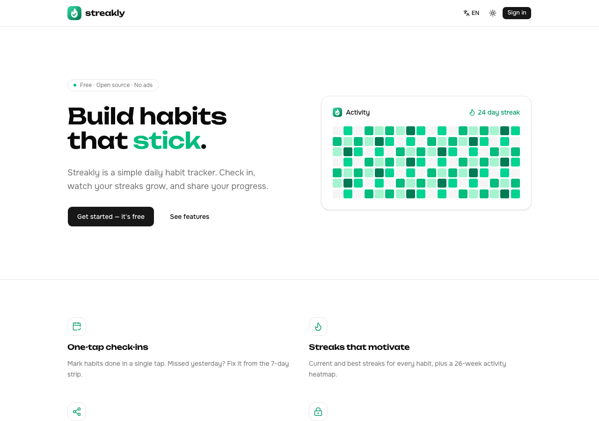
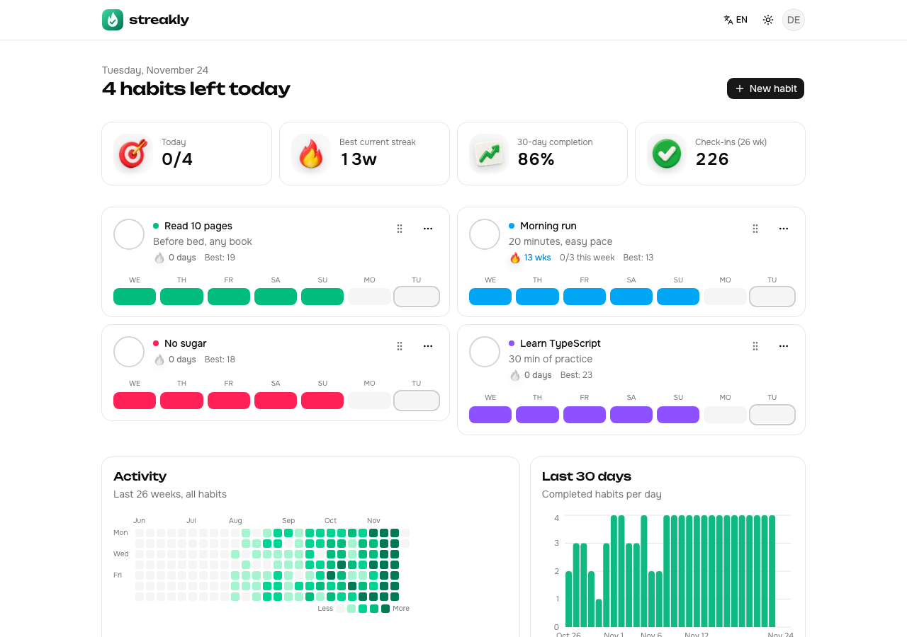
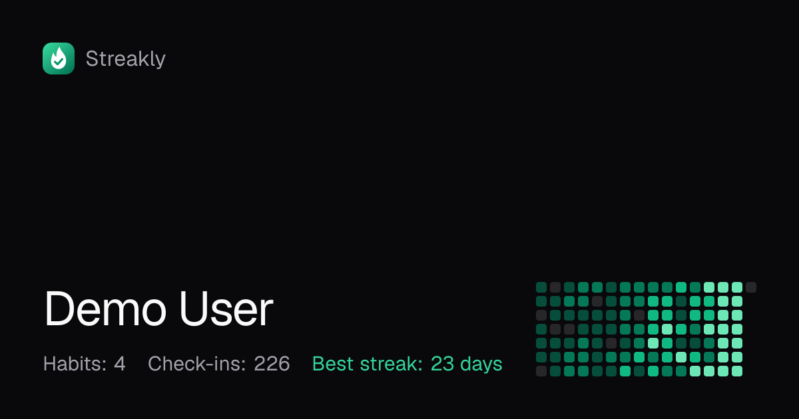

# Streakly

[](https://github.com/MasrurMansurov/streakly/actions/workflows/ci.yml)

A daily habit tracker with streaks, a GitHub-style activity heatmap and shareable public profiles.

**🌐 Live:** https://streakly-pied-six.vercel.app

**Demo account:** `demo@streakly.dev` / `streakly-demo` · public profile: [/u/demo](https://streakly-pied-six.vercel.app/u/demo)

<p align="center">
  
</p>
<p align="center">
  
  
</p>
<p align="center">
  
  
</p>

## Features

- **One-tap check-ins** with optimistic UI (`useOptimistic`), plus a 7-day strip to fix missed days
- **Streaks:** current and best streak per habit, 30-day completion rate
- **Flexible goals:** every day or N× per week (weekly habits keep streaks in weeks)
- **Activity heatmap** (26 weeks) and a 30-day bar chart (Recharts)
- **Drag-and-drop ordering** (dnd-kit) — mouse, touch and keyboard, with screen reader announcements
- **Habit page** with a 12-month heatmap, monthly chart and weekday breakdown; **archive** with restore and undo
- **Notes on check-ins** — private, owner-only (kept out of the world-readable logs table)
- **Friends** — follow public profiles; a 7-day feed of their check-ins. Follow lists are visible only to the two people involved
- **Achievements** — badges for 7/30/100-day streaks and 1/100/500 check-ins, with progress bars and an unlock toast; all-time stats are computed in Postgres (gaps-and-islands window query)
- **Profile photo** upload to Supabase Storage (per-user folder, size/type limits enforced by the bucket and RLS)
- **Public profile** at `/u/<username>`, opt-in; archived habits stay private, with a generated OG image for link previews
- **Auth:** email + password, optional GitHub / Google OAuth, via Supabase Auth with cookie sessions (`@supabase/ssr`)
- **Timezone-aware:** "today" is computed in the user's own timezone, not the server's
- **Daily reminders (Web Push):** pick a time; a notification arrives only if habits are still due today. Supabase `pg_cron` calls an Edge Function every 15 min; VAPID keys and the cron token live in Supabase Vault
- **English & Russian:** `/en/…` and `/ru/…` URLs (language picked from the browser, switcher in the header), proper Russian plurals via `Intl.PluralRules`, localized dates, validation messages and push notifications
- **Installable (PWA):** add to the home screen and open full-screen, with app icons and theme colors
- **Brand & type:** custom logo (a flame with a check mark cut in — streak + habit done), Unbounded for headings, Onest for text; both with full Cyrillic
- **3D icons & motion (inside the app):** a custom clay-style 3D icon set, staggered entrance, check-in confetti, floating hero icons — all CSS, disabled for `prefers-reduced-motion`
- Dark mode, responsive layout, accessible controls

## Tech stack

| | |
|---|---|
| Framework | Next.js 16 (App Router, Server Actions, Cache Components, Partial Prefetching) |
| Language | TypeScript (strict) |
| UI | Tailwind CSS v4, shadcn/ui (Base UI), lucide-react, sonner, next-themes |
| Forms | react-hook-form + zod (same schemas validate on client and server) |
| Backend | Supabase: Postgres, Auth, Storage, Row Level Security, Edge Functions (Deno), pg_cron, Vault |
| Charts | Recharts + a hand-made heatmap |
| Tests | Vitest (unit) + Playwright (e2e, desktop & mobile) |
| CI | GitHub Actions: lint, typecheck, unit tests, build |
| Hosting | Vercel (auto-deploy from `main`) |

## Architecture

```
src/
├── proxy.ts                  # refreshes the Supabase session, guards /dashboard and /settings
├── app/
│   ├── page.tsx              # landing (static)
│   ├── login/                # sign in / sign up
│   ├── auth/callback/        # email confirmation → session
│   ├── (app)/dashboard/      # habits, stats, heatmap, chart
│   ├── (app)/settings/       # profile and public toggle
│   ├── u/[username]/         # public profile (server-cached, tag-invalidated)
│   └── actions/              # server actions; each one re-checks the session
└── lib/
    ├── data.ts               # data access layer (server-only)
    ├── streaks.ts, dates.ts  # pure logic, unit-tested
├── i18n/                     # dictionaries (en, ru), locale helpers, plurals
    ├── validation.ts         # zod schemas
    └── supabase/             # server, proxy and public clients + generated types
supabase/migrations/          # schema, RLS policies, triggers, cron job
supabase/functions/           # send-reminders Edge Function (Web Push)
```

### Database

```
auth.users ─1:1─ profiles (username, display_name, bio, is_public)
                    └─1:n─ habits (name, color, position, archived_at)
                              └─1:n─ habit_logs (log_date)  unique(habit_id, log_date)
```

**Security is enforced in Postgres, not in the UI:**
- RLS on every table. Owners have full access. Anyone can *read* rows of profiles with `is_public = true`.
- A trigger checks that a log belongs to a habit of the same user.
- A profile row is created automatically on sign-up (a `security definer` trigger, not callable through the API).

**Caching:** public profiles are fetched with a cookie-less anon client inside `"use cache"` and invalidated with `updateTag("profile:<username>")` when the owner changes data. Authenticated pages are rendered at request time behind `<Suspense>`.

## Getting started

```bash
npm install
cp .env.example .env.local   # fill in your Supabase URL and publishable key
npm run dev
```

### OAuth (optional)

1. Create an OAuth app ([GitHub](https://github.com/settings/developers) / [Google Cloud](https://console.cloud.google.com/apis/credentials)) with the callback URL `https://<project-ref>.supabase.co/auth/v1/callback`.
2. Enable the provider in Supabase → Authentication → Sign In / Providers with its client ID and secret.
3. Add `https://your-domain/**` to Supabase → Authentication → URL Configuration → Redirect URLs.
4. Set `NEXT_PUBLIC_AUTH_PROVIDERS=github,google` and redeploy.

Apply the migrations from `supabase/migrations` to your Supabase project (SQL editor or `supabase db push`).

```bash
npm test          # unit tests
npm run e2e       # Playwright e2e (builds and starts the app on :3100)
E2E_BASE_URL=https://streakly-pied-six.vercel.app npm run e2e   # against production
npm run typecheck
npm run lint
npm run build
```

## Roadmap

- [x] Google / GitHub OAuth (behind `NEXT_PUBLIC_AUTH_PROVIDERS`)
- [x] Drag-and-drop habit ordering (dnd-kit)
- [x] Weekly targets ("3× per week")
- [x] Reminders (Edge Function + cron)
- [x] OG image for public profiles
- [x] Playwright e2e tests

## Credits

3D icons: a custom clay-style set made for Streakly — generated with Canva AI and cut out from the background with a small numpy/scipy script.
